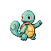
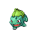
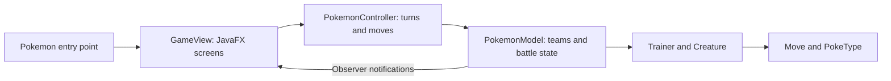

# Pokémon Battle Simulator

A JavaFX desktop battle game built for CSC 335 in Fall 2025. Choose a team, battle a computer opponent at three difficulty levels, or play locally with a second player. The project separates the game model, battle controller, and graphical interface, with JUnit 5 tests for core behavior.

<p align="center">
  
  
  
  
</p>

**Desktop application:** Java · JavaFX · JUnit 5 · MVC · Observer pattern

[Project presentation](final_project_presentation_335.pdf) · [UML diagram](src/Pokemon_UML_Diagram_Updated.drawio) · [Development notes](Notes/Notes.txt)

## Features

- Team selection from a roster of 12 creatures.
- Turn-based battles with moves, health tracking, creature switching, and knockout handling.
- Single-player battles with Easy, Medium, and Hard choices.
- Local two-player mode sharing the desktop interface.
- Sprite-based battle screens updated through model notifications.

Online multiplayer is unfinished: its menu button is disabled. `Client.java` and `Server.java` are connection experiments, not a working network battle mode. There is no hosted browser demo.

## Architecture



| Location | Purpose |
| --- | --- |
| `src/Pokemon.java` | Desktop entry point |
| `src/GameView.java` | Menus, team selection, and battle UI |
| `src/controller/` | Battle orchestration and computer turns |
| `src/model/` | Creatures, trainers, moves, and state |
| `src/Tests/` | JUnit 5 tests |
| `src/sprites/` | Creature and trainer artwork |
| `Notes/` | Team planning and retrospectives |

## Run locally

Use a JDK with a compatible JavaFX SDK. The repository includes Eclipse project metadata and JUnit 5 configuration; it does not include a Maven or Gradle build or bundle JavaFX.

1. Clone the repository and import it in Eclipse using **Existing Projects into Workspace**.
2. Configure the project's JRE to use your installed JDK.
3. Add the JavaFX SDK JARs to the build path. The existing `.classpath` names both `JavaFX` and `javaFX` user libraries; replace these machine-specific references with your configured library.
4. In the run configuration for `Pokemon`, set the working directory to the repository root and add these VM arguments, substituting your JavaFX SDK path:

   ```text
   --module-path "C:\path\to\javafx-sdk\lib" --add-modules javafx.controls
   ```

5. Ensure `src/sprites` is copied into the output as `sprites`, then run `Pokemon` as a Java application.

Choose creatures from the menu, then select **Single Player** or **Local Multiplayer**. Start with Easy for an initial walkthrough.

## Tests and verification

Add JUnit 5 to the Eclipse build path and run `src/Tests` as JUnit tests. The suite includes creature, move, trainer, roster, and controller tests. Tests and desktop gameplay have not been re-run as part of the repository documentation update; no passing CI or current runtime verification is claimed.

The root `index.html` is an incomplete generated Javadoc entry page, not a playable web version. Read the Java sources or regenerate Javadoc locally for API documentation.

## Team and attribution

Created by Conor, Jett, Mohammad, and Safwan for CSC 335, Fall 2025. This repository preserves the shared coursework and its commit history; it is a team project.

Pokémon names, characters, and related artwork belong to their respective rights holders. This is an unofficial educational project, with no affiliation or endorsement. Bundled sprites are shown as project assets; no original-artwork claim is made. No additional software or artwork license is granted by this README.
